

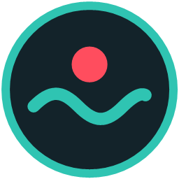

# Tonle Rec

### Free screen recorder for Windows — with auto zoom, AI noise removal and Khmer captions
### កម្មវិធីថតអេក្រង់ឥតគិតថ្លៃ សម្រាប់ Windows · បង្កើតនៅកម្ពុជា 🇰🇭

 

  

  

**100% free · No watermark · No account · No subscription · Works offline** 
**ឥតគិតថ្លៃ ១០០% · គ្មានស្លាកសញ្ញាទឹក · មិនចាំបាច់បង្កើតគណនី · គ្មានការជាវ · ប្រើបានដោយគ្មានអ៊ីនធឺណិត**

 

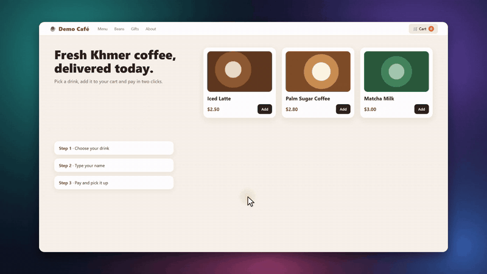

Made with Tonle Rec: auto zoom, smooth cursor and click effects — no editing needed.

---

## 🎬 Record in one click · ថតបានភ្លាមៗ

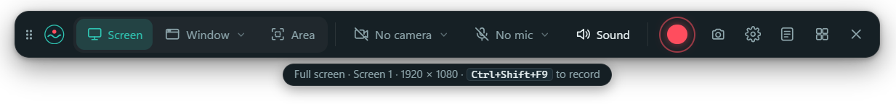

Choose **Screen**, **Window** or **Area**, pick your camera and mic, and press the red button.
When you stop, the editor opens by itself.

ជ្រើសរើស **អេក្រង់**, **វីនដូ** ឬ **តំបន់** ជ្រើសកាមេរ៉ា និងមីក្រូហ្វូន រួចចុចប៊ូតុងក្រហម។ ពេលបញ្ឈប់ កម្មវិធីកែវីដេអូនឹងបើកដោយខ្លួនឯង។

---

## ✨ Features · មុខងារ

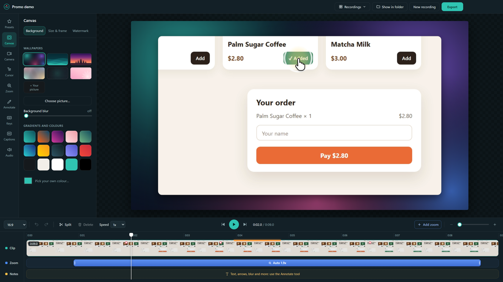

| | Feature | មុខងារ |
|:-:|---|---|
| 🎥 | **Record anything** — full screen, one window or any area, smooth **60 fps**, up to 4K | ថតអេក្រង់ទាំងមូល វីនដូ ឬតំបន់ណាមួយ រលូន **៦០ fps** |
| 🔍 | **Auto zoom** — zooms in wherever you click, glides smoothly between spots | ពង្រីកដោយស្វ័យប្រវត្តិ ត្រង់កន្លែងដែលអ្នកចុច |
| 🖱️ | **Beautiful cursor** — 6 cursor styles, smooth movement, click ripples, highlight glow | ទស្សន៍ទ្រនិចស្អាត ចលនារលូន ឥទ្ធិពលពេលចុច |
| ⌨️ | **Keyboard pop-ups** — shows shortcuts like `Ctrl + C` on screen (the letters you type are never saved) | បង្ហាញគ្រាប់ចុចផ្លូវកាត់លើអេក្រង់ |
| 🎙️ | **AI noise removal** — fans, keyboard and room noise go away, your voice stays | AI លុបសំឡេងរំខាន ទុកតែសំឡេងរបស់អ្នក |
| 🎚️ | **Separate sound tracks** — mic and computer sound, each with its own volume and mute | មីក្រូហ្វូន និងសំឡេងកុំព្យូទ័រ មានបទដាច់ដោយឡែក |
| 💬 | **Captions in Khmer and English** — made on your computer, editable, saved as `.srt` too | អក្សររត់ជាភាសាខ្មែរ និងអង់គ្លេស |
| 📷 | **Camera** — bubble, square or side by side, background blur or removal | កាមេរ៉ា និងលុប/ធ្វើព្រិលផ្ទៃខាងក្រោយ |
| 🎨 | **Backgrounds & frames** — wallpapers, colours, your own picture, rounded corners, shadow | ផ្ទៃខាងក្រោយ និងស៊ុមស្អាតៗ |
| ✏️ | **Annotations** — text, arrows, boxes, highlight, blur, spotlight, step numbers | អក្សរ ព្រួញ ប្រអប់ ធ្វើព្រិល |
| ✂️ | **Easy timeline** — cut, speed up parts, zoom blocks, music with auto-lowering while you talk | កាត់ បង្កើនល្បឿន បន្ថែមតន្ត្រី |
| 💾 | **Export** — MP4 (H.265 small files or H.264 for every device), 720p to 4K, GIF, **no watermark** | នាំចេញ MP4 ដល់ 4K ឬ GIF · គ្មានស្លាកសញ្ញាទឹក |

<table>
<tr>
<td width="33%" align="center">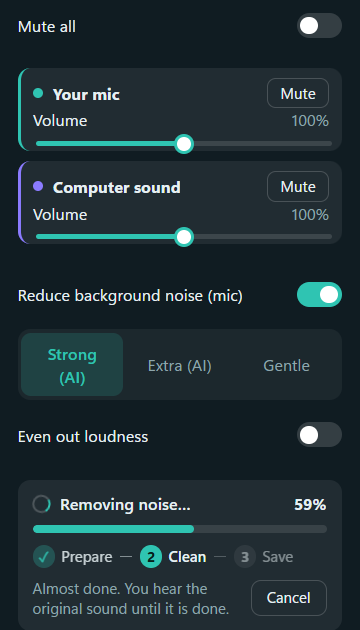 <b>AI noise removal</b> Strong, Extra or Gentle · with progress and compare</td>
<td width="33%" align="center">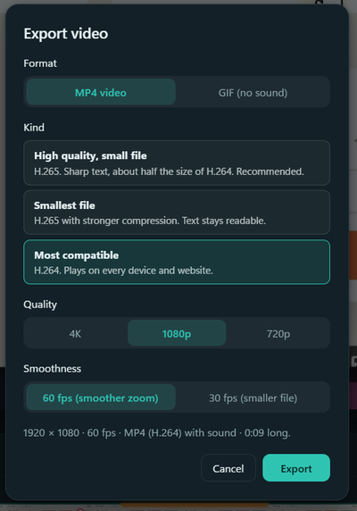 <b>Export</b> High quality, smallest file or most compatible</td>
<td width="33%" align="center">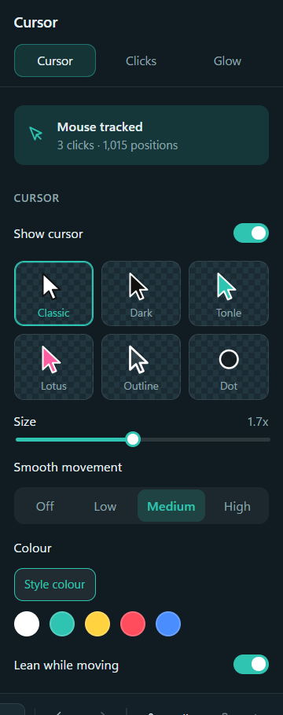 <b>Cursor</b> Styles, size, smoothing and colour</td>
</tr>
</table>

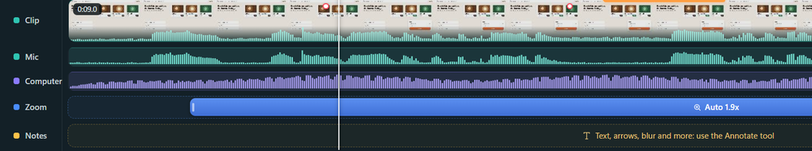 
Your mic and the computer sound on their own tracks, under the clip, zooms and notes.
  
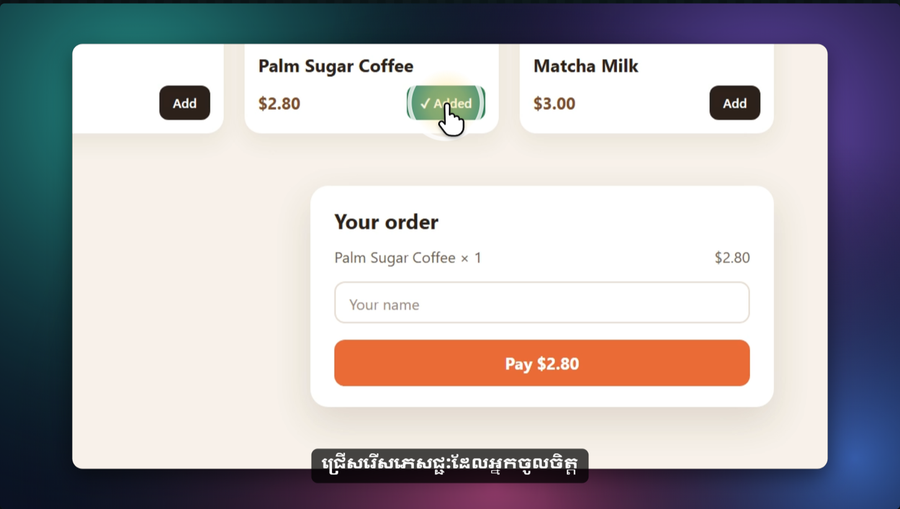 
Khmer captions on the video, on a wallpaper background.
  
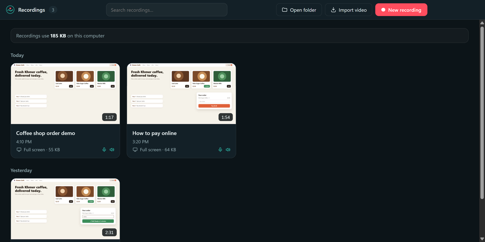 
All your recordings in one place: search, rename, play the export, free up space.

---

## ⬇ Install · របៀបដំឡើង

1. **[Download `Tonle-Rec-Setup.exe`](https://github.com/ChetDevelopment/Tonle-Record/releases/latest/download/Tonle-Rec-Setup.exe)** (about 160 MB). 
   ទាញយកឯកសារ **Tonle Rec Setup** (ប្រហែល 160 MB)។
2. Open it and follow the steps. A Tonle Rec icon appears on your desktop. 
   បើកវា ហើយធ្វើតាមជំហាន។ រូប Tonle Rec នឹងបង្ហាញលើ Desktop។
3. **If Windows says "Windows protected your PC":** click **More info**, then **Run anyway**. 
   **បើ Windows បង្ហាញ "Windows protected your PC":** ចុច **More info** រួចចុច **Run anyway**។

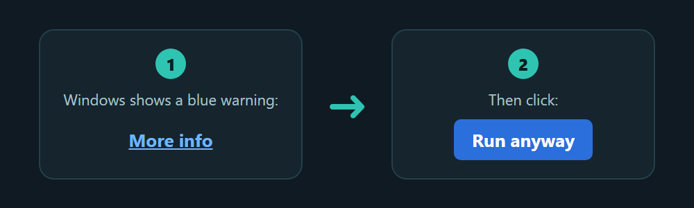

> **Why the warning?** Tonle Rec is new and not "code-signed" yet (a signing certificate costs money every year),
> so Windows shows this for new free apps until they are downloaded by many people. It is safe to continue. 
> **ហេតុអ្វីមានការព្រមាន?** Tonle Rec ជាកម្មវិធីថ្មី មិនទាន់មានហត្ថលេខាឌីជីថល (ត្រូវបង់លុយរៀងរាល់ឆ្នាំ)
> ដូច្នេះ Windows បង្ហាញសារនេះសម្រាប់កម្មវិធីឥតគិតថ្លៃថ្មីៗ។ អ្នកអាចបន្តបានដោយសុវត្ថិភាព។

**System requirements · តម្រូវការ**

| | |
|---|---|
| System | Windows 10 or Windows 11, 64-bit |
| Disk space | about 450 MB for the app, plus space for your recordings |
| Recommended | a graphics card (NVIDIA, AMD or Intel) for fast recording and export |
| Captions (optional) | a one-time download of the caption model (about 60–480 MB) when you first use it |

---

## 🔒 Privacy · ឯកជនភាព

- **Everything stays on your computer.** Recording, editing, AI noise removal and captions all run offline.
- **Nothing is uploaded.** Tonle Rec has no account and no tracking.
- **Your typing is private.** For the keyboard pop-ups only shortcuts (like `Ctrl + S`) are kept — never the letters you type.

អ្វីៗទាំងអស់នៅលើកុំព្យូទ័ររបស់អ្នក · មិនបញ្ជូនវីដេអូទៅណាទេ · មិនរក្សាទុកអក្សរដែលអ្នកវាយ។

---

## ❓ FAQ · សំណួរញឹកញាប់

<b>Is it really free? · ពិតជាឥតគិតថ្លៃមែនទេ?</b>

Yes. Tonle Rec is free to download and use, with no watermark, no time limit and no paid version. 
បាទ/ចាស ឥតគិតថ្លៃ គ្មានស្លាកសញ្ញាទឹក គ្មានកំណត់ពេល។

<b>Does it work on Mac? · ប្រើលើ Mac បានទេ?</b>

Not yet — Tonle Rec is for Windows 10 and 11 for now. 
មិនទាន់ទេ បច្ចុប្បន្នសម្រាប់តែ Windows 10 និង 11។

<b>How do I update? · ធ្វើបច្ចុប្បន្នភាពយ៉ាងដូចម្តេច?</b>

Download the newest installer from <a href="https://github.com/ChetDevelopment/Tonle-Record/releases/latest">Releases</a> and run it.
Your recordings and settings are kept. 
ទាញយកកម្មវិធីដំឡើងថ្មីបំផុត ហើយដំណើរការវា។ វីដេអូ និងការកំណត់របស់អ្នកនៅដដែល។

<b>Where are my recordings saved? · វីដេអូរក្សាទុកនៅឯណា?</b>

In <code>Videos\Tonle Rec</code>. Exported videos are saved there too.

<b>I found a problem / I have an idea · ខ្ញុំរកឃើញបញ្ហា ឬមានគំនិត</b>

Please open an <a href="https://github.com/ChetDevelopment/Tonle-Record/issues">issue</a> and tell us what happened. Screenshots help a lot.

---

## 📄 Licence · អាជ្ញាប័ណ្ណ

Tonle Rec is free to use. Its own source code is not public.
It includes free and open-source parts made by others — FFmpeg (GPL-3.0), DeepFilterNet (MIT / Apache-2.0),
RNNoise (BSD), MediaPipe (Apache-2.0), Electron (MIT), React (MIT) and more.
Their licences and source links are in [`licenses/THIRD-PARTY-NOTICES.txt`](licenses/THIRD-PARTY-NOTICES.txt),
and also in the `licenses` folder where Tonle Rec is installed.

 
<b>Made with ❤️ in Cambodia · បង្កើតដោយក្តីស្រលាញ់ នៅកម្ពុជា</b> 
© 2026 Tonle Rec

